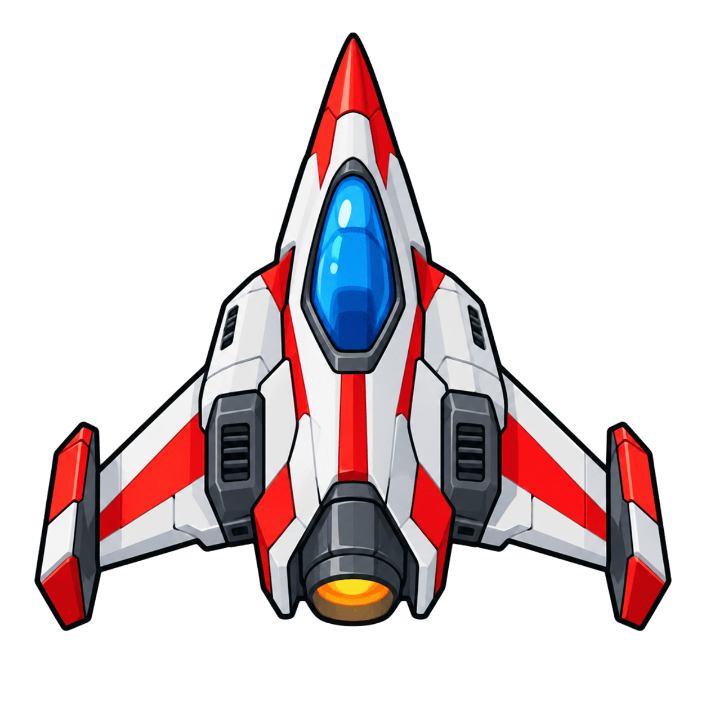
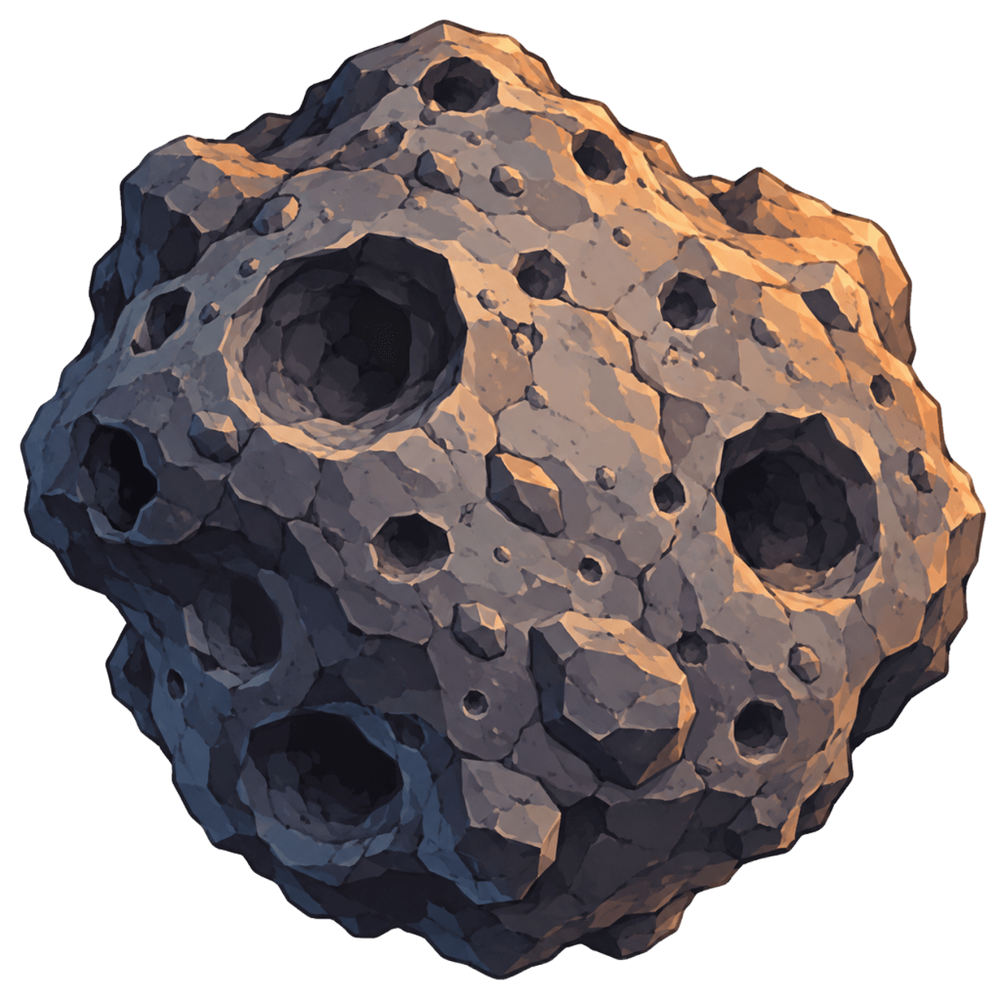
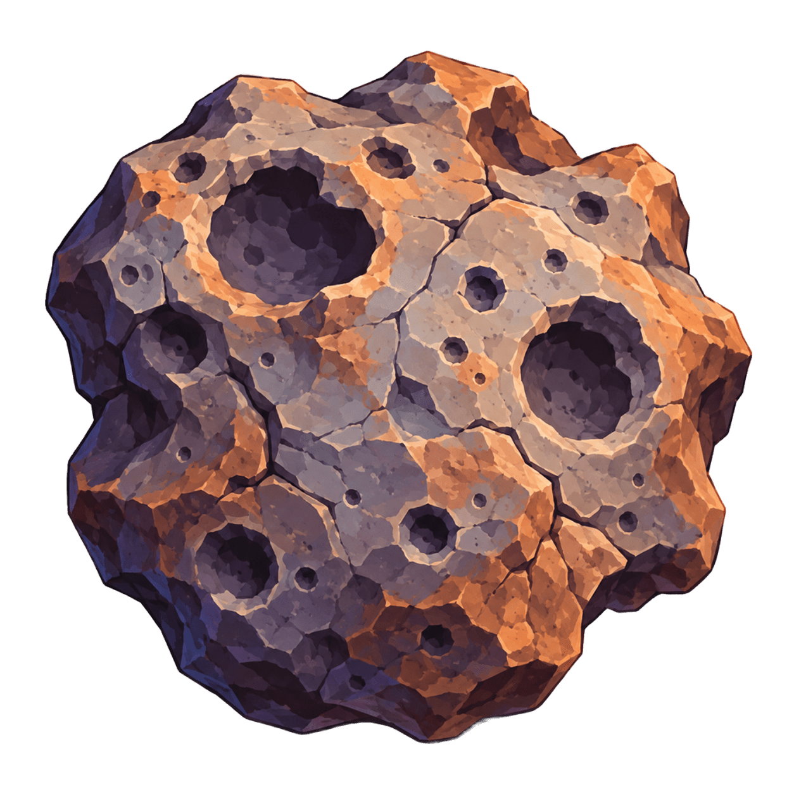
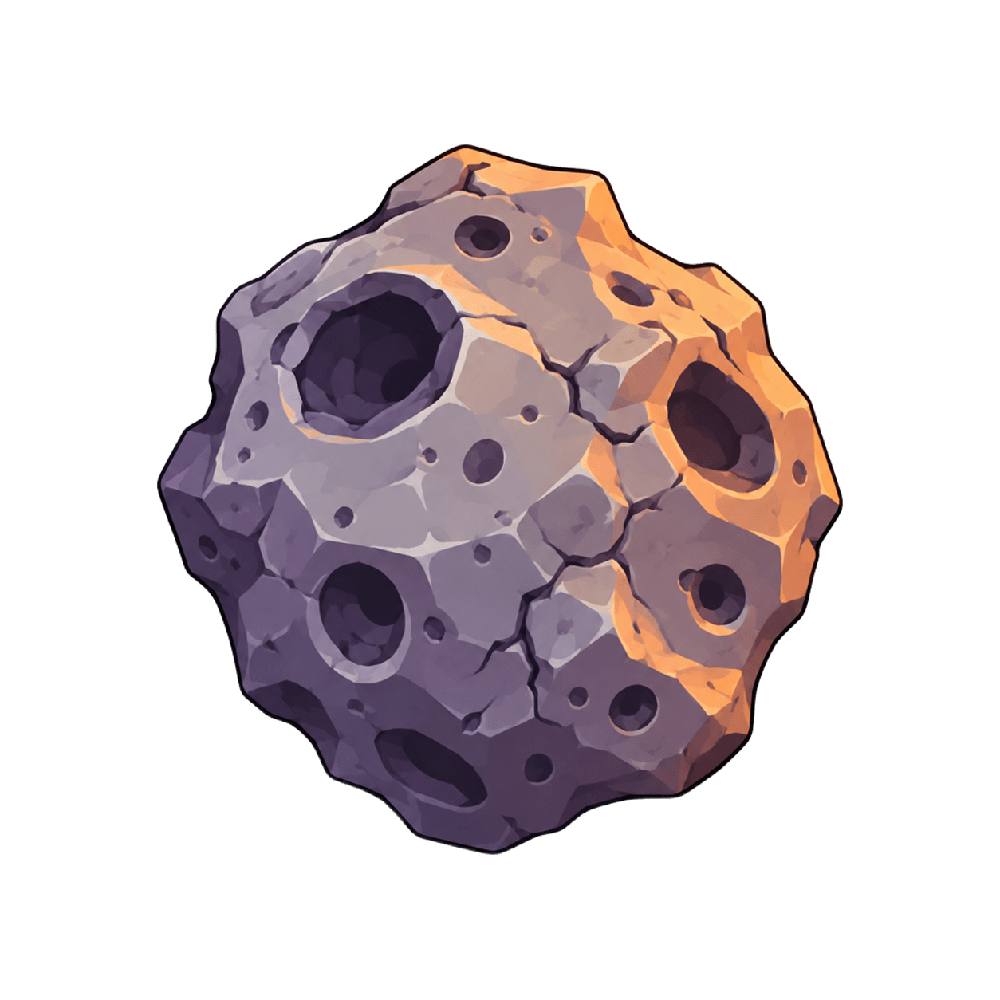

# Asteroids

A classic arcade Asteroids remake built in Python using Pygame. The game features 2D sprite rendering, split physics, collision shields, screen wrapping, sound effects with independent volume sliders, and a persistent SQLite leaderboard.

It is a clean, modular project designed as a learning and portfolio showcase rather than a groundbreaking commercial title.

---

## Gameplay Demo

A quick gameplay preview is included in the repository:

- **Demo Video:** [`assets/Readme/demo.mp4`](assets/Readme/demo.mp4)

---

## Asset Architecture & Showcase

The game replaces classic vector wireframes with custom 2D sprites managed by [`asset_loader.py`](asset_loader.py). Assets are cached in memory upon first load and scaled smoothly to match logical collision hitboxes.

### 1. Player Spaceship
- **Asset:** [`assets/spaceship.png`](assets/spaceship.png)
- **Rendering:** Rotated dynamically based on player orientation (`180 - rotation`). A luminous shield ring and respawn invulnerability glow are drawn directly around the sprite hitbox.

<p align="center">
  
</p>

### 2. Multi-Tier Asteroids
Asteroids are dynamically split upon impact into smaller fragments. Each tier maps to a custom sprite scaled to match its logical collision radius:

| Tier | Size Radius | Asset | Preview | Split Behavior |
| :--- | :--- | :--- | :---: | :--- |
| **Tier 3 (Large)** | `radius > 40` | [`assets/asteriods_big.png`](assets/asteriods_big.png) |  | Splits into two Medium asteroids |
| **Tier 2 (Medium)** | `20 < radius <= 40` | [`assets/asteriods_mid.png`](assets/asteriods_mid.png) |  | Splits into two Small asteroids |
| **Tier 1 (Small)** | `radius <= 20` | [`assets/asteriods_small.png`](assets/asteriods_small.png) |  | Destroyed entirely on hit |

### 3. Background & Audio
- **Background:** [`assets/background.png`](assets/background.png) provides an ambient starfield backdrop.
- **Audio:** Managed by [`sound_manager.py`](sound_manager.py) with independent volume channels for background music ([`assets/music/bg_music.mp3`](assets/music/bg_music.mp3)) and sound effects ([`single_shot.mp3`](assets/music/single_shot.mp3), [`asteroid_destruction.mp3`](assets/music/asteroid_destruction.mp3)).

---

## Features

- **2D Sprite Graphics:** Sprite caching and smoothscaling with wireframe fallback.
- **Collision Shield & Invulnerability:** Visual energy barrier rendered around the ship during respawn and active play.
- **Torus Screen Wrapping:** Ship, bullets, and asteroids wrap seamlessly around window edges.
- **Audio Control System:** Real-time volume controls for music and sound effects with instant mute toggle.
- **Persistent Leaderboard:** Local SQLite database records top high scores and timestamps.
- **Game States & Menus:** Clean state transitions between Main Menu, Gameplay, Pause, Audio Settings, Game Over, and Leaderboard.

---

## How to Try It Out

### Prerequisites
- **Python 3.13+** (or Python 3.12+)
- [`uv`](https://github.com/astral-sh/uv) (recommended) or standard `pip`

### Method A: Using `uv` (Recommended)

1. **Clone the repository:**
   ```bash
   git clone https://github.com/Zeeshan506/Asteroids.git
   cd Asteroids
   ```

2. **Run the game directly:**
   ```bash
   uv run main.py
   ```

3. **Run automated test suite:**
   ```bash
   uv run pytest
   ```

---

### Method B: Using standard Python venv & pip

1. **Clone the repository:**
   ```bash
   git clone https://github.com/Zeeshan506/Asteroids.git
   cd Asteroids
   ```

2. **Create and activate a virtual environment:**
   ```bash
   python3 -m venv .venv
   source .venv/bin/activate  # On Windows: .venv\Scripts\activate
   ```

3. **Install dependencies:**
   ```bash
   pip install pygame==2.6.1 pytest>=9.1.1
   ```

4. **Launch the game:**
   ```bash
   python main.py
   ```

---

## Controls

### Ship Flight & Combat
| Action | Key |
| :--- | :--- |
| **Thrust Forward** | `W` |
| **Reverse Thrust** | `S` |
| **Rotate Ship Left** | `A` |
| **Rotate Ship Right** | `D` |
| **Fire Laser Cannon** | `Space` |

### Audio & System
| Action | Key |
| :--- | :--- |
| **Pause / Resume** | `P` |
| **Toggle Mute** | `M` |
| **Music Volume Up / Down** | `]` / `[` |
| **SFX Volume Up / Down** | `+` (or `=`) / `-` |
| **Return to Menu** | `Esc` |

### Menus & Screens
| Action | Key |
| :--- | :--- |
| **Navigate Options** | `Up` / `Down` Arrow (or `W` / `S`) |
| **Select / Confirm** | `Enter` or `Space` |
| **Restart Game (Game Over)** | `R` |
| **View Leaderboard (Game Over)** | `L` |

---

## Project Structure

```
├── asset_loader.py         # Texture caching, scaling, and asset retrieval
├── asteroid.py             # Asteroid entity and splitting logic
├── asteroidfield.py        # Asteroid spawning mechanics
├── circleshape.py          # Base collision class (circular hitboxes)
├── constants.py            # Global dimensions, speeds, and timings
├── game_state_manager.py   # State machine, scoring, lives, and timers
├── hud.py                  # HUD rendering, overlays, pause, game-over screens
├── leaderboard_manager.py  # SQLite persistent score tracking
├── logger.py               # JSONL structured event and state logging
├── main.py                 # Core game loop and event processing
├── menu.py                 # Interactive menus (Main, Leaderboard, Audio)
├── player.py               # Ship controls, physics, and shield rendering
├── screen_wrap.py          # Torus boundary wrapping mathematics
├── shot.py                 # Bullet physics and projectile life cycle
├── sound_manager.py        # Defensive mixer, audio volume & playback
├── assets/                 # PNG sprites, MP3 sound effects, demo video
└── tests/                  # Automated unit and integration test suite
```

---

## Modularity & Verification

Every module is strictly capped at under 300 lines of code to maintain clarity and ease of maintenance. You can verify modularity and test coverage at any time:

```bash
uv run python scripts/check_line_counts.py
uv run pytest
```
